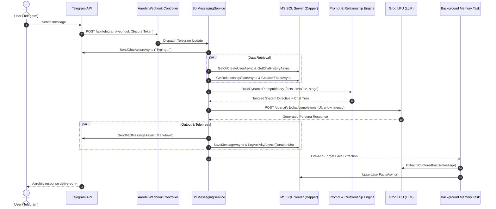

# 🌸 Aarohi — AI Companion & Conversational Intelligence Engine

[](https://dotnet.microsoft.com/)
[](https://learn.microsoft.com/en-us/dotnet/csharp/)
[](https://core.telegram.org/bots/api)
[](https://groq.com/)
[](https://www.microsoft.com/sql-server)
[](https://github.com/DapperLib/Dapper)
[](https://www.docker.com/)

> **Aarohi** is not another generic "How may I help you?" chatbot. She is an authentic, empathetic, and witty AI companion engineered in **.NET 8**, powered by **Groq LPU LLM inference**, **Telegram Webhooks**, and a high-performance **MS SQL Server + Dapper** persistence layer.
>
> Designed with a dynamic relationship progression engine, long-term memory extraction, and conversational pacing rules that mimic genuine human connection.

---

## 💡 The Philosophy Behind Aarohi

Most conversational bots sound like corporate assistants or interrogation machines that end every single sentence with a question. **Aarohi was built differently.**

She personifies a 23-year-old creative marketing professional living in Bengaluru — vibrant, perceptive, empathetic, and playfully witty. She speaks in natural, contemporary **Hinglish** (*informal "tum/tumhara"*, zero repetitive filler slang), drops relatable Bangalore snippets (Indiranagar cafes, Koramangala traffic, filter coffee), and connects with users organically over time.

---

## ✨ Key Features & Architectural Highlights

### 🧠 1. Dynamic Relationship Engine
Conversations aren't static; relationships evolve. Aarohi implements a state machine that tracks interaction depth across three quantitative metrics:
* **`FamiliarityScore`** (0–100) — How much conversational ground has been covered.
* **`TrustScore`** (0–100) — Built through consistent check-ins and shared personal reflections.
* **`IntimacyScore`** (0–100) — Emotional depth and shared vulnerability.

Based on these scores, the bot dynamically transitions through **4 progressive stages**:
1. **Stranger (Level 1)**: Warm, low-pressure greetings, establishing comfort.
2. **Acquaintance (Level 2)**: Recognizing routines, perceptive mood guesses, gentle curiosity.
3. **Friend (Level 3)**: Playful teasing (*nautanki*, *champu*), shared laughs, comfortable banter.
4. **Close Friend (Level 4)**: Emotional solidarity, affectionate nicknames, unconditional support during stress.

---

### 🎭 2. The "Anti-Interrogation" Conversational Pacing
Humans don't text like interviewers. Aarohi's dynamic prompt builder enforces psychological conversational principles:
* **The Patrick Jane Mentalist Technique**: Instead of dry questions (*"How was your day?"*), she uses perceptive cold reads (*"You have that exact 'my screen drained my soul today' vibe. Tell me I'm wrong."*).
* **Question Pacing & Alternation**: Explicit rules prevent asking consecutive questions. Statements, humorous retorts, and comfort carry the dialogue.
* **Dynamic Time Cues**:
  * *Late Night (IST)*: Quiet, cozy, slow-paced presence.
  * *Morning (IST)*: Crisp caffeine energy and rush-hour optimism.
* **Input-Sensitive Dynamics**:
  * *Dry 1-word replies ("haan", "theek")*: Lightly teased for low energy (*"Itna dry? Who hurt you today?"*).
  * *Long vents*: Validated with deep empathy without demanding answers.

---

### 💾 3. Asynchronous Context Memory Extraction
Aarohi remembers details without slowing down response times:
* **Non-blocking background extraction**: Personal facts (job, city, hobbies, stress triggers, milestones) are identified from incoming chat turns and upserted into `dbo.UserFacts`.
* **Dynamic Memory Injection**: Active facts are surfaced directly into the prompt context for subsequent turns, enabling genuine long-term recall.

---

## 🏛️ System Architecture



---

## 🛠️ Tech Stack & Engineering Decisions

| Component | Choice | Engineering Rationale |
| :--- | :--- | :--- |
| **Framework** | **.NET 8 Web API** | Enterprise-grade speed, modern C# 12 language features, unified dependency injection, and minimal overhead. |
| **Data Access** | **Dapper 2.1** | Micro-ORM providing blazing raw SQL throughput, avoiding EF Core change-tracking overhead for high-frequency chat logging. |
| **Database** | **Microsoft SQL Server** | Robust transactional integrity, normalized indexing across 6 core tables, foreign key cascades, and temporal query support. |
| **LLM Inference** | **Groq LPU (OpenAI SDK Compatible)** | Sub-second inference latency critical for live chat feel; dynamic model routing between fast and deep tiers. |
| **Bot Gateway** | **Telegram.Bot 19.0 + NewtonsoftJson** | Official Telegram SDK coupled with `Microsoft.AspNetCore.Mvc.NewtonsoftJson` to resolve polymorphic JSON deserialization of webhook payloads. |
| **Container** | **Docker Multi-Stage Build** | Lightweight production image (`aspnet:8.0-alpine` / `jammy`), optimized build caching, environment variable injection. |
| **Deployment** | **TrueNAS SCALE + Cloudflare Tunnels** | Self-hosted on dedicated infrastructure; zero-open-port HTTPS ingress via Cloudflare Tunnel. |

---

## 🗄️ Database Architecture

The data tier is structured for strict accountability, analytics, and context retention:

* **`dbo.Users`**: Telegram user identities, onboarding state, active relationship level, and language preference.
* **`dbo.Messages`**: Complete chronological chat history with token expenditure, model tags, and latency tracking.
* **`dbo.UserFacts`**: Relational knowledge base categorizing extracted user data (`Work`, `City`, `Preference`, `Milestone`).
* **`dbo.ScheduledNotifications`**: Automated retention and check-in queue ready for cron/n8n workers.
* **`dbo.ActivityLogs`**: Granular performance telemetry auditing operation durations (`DurationMs`) and success flags.
* **`dbo.ErrorLogs`**: Resilient exception tracking logging full stack traces, component sources, and request context.

---

## 🚀 Getting Started

### Prerequisites
* [.NET 8.0 SDK](https://dotnet.microsoft.com/download/dotnet/8.0)
* [SQL Server 2019+](https://www.microsoft.com/sql-server) (or Azure SQL / LocalDB)
* [Groq Cloud API Key](https://console.groq.com/)
* A Telegram Bot Token from [@BotFather](https://t.me/BotFather)

### 1. Clone & Setup
```bash
git clone https://github.com/HimanshuPatil2001/Aarohi-Bot.git
cd Aarohi-Bot
```

### 2. Database Migration
Execute [`Database/schema.sql`](Database/schema.sql) in SQL Server Management Studio (SSMS) or via `sqlcmd`:
```bash
sqlcmd -S localhost -U sa -P "YourPassword" -i Database/schema.sql
```

### 3. Local Configuration
Sensitive credentials should be kept in `appsettings.Development.json` (which is git-ignored) or via [.NET User Secrets](https://learn.microsoft.com/en-us/aspnet/core/security/app-secrets):

```json
{
  "ConnectionStrings": {
    "DefaultConnection": "Server=localhost,1433;Database=companion Db;User Id=sa;Password=YourPassword;TrustServerCertificate=True"
  },
  "Telegram": {
    "BotToken": "YOUR_TELEGRAM_BOT_TOKEN",
    "WebhookSecretToken": "YOUR_OPTIONAL_WEBHOOK_SECRET"
  },
  "Groq": {
    "ApiKey": "YOUR_GROQ_API_KEY",
    "FastModel": "openai/gpt-oss-20b",
    "DeepModel": "openai/gpt-oss-120b"
  }
}
```

### 4. Run the API
```bash
dotnet restore
dotnet build
dotnet run
```
Swagger UI will be available at `http://localhost:5000/swagger`.

---

## 🐳 Docker Deployment

A production-ready `Dockerfile` and `docker-compose.yml` are included:

```bash
docker-compose up -d --build
```

Environment variables can be provided directly via `.env` or container runtime variables:
```yaml
environment:
  - ASPNETCORE_ENVIRONMENT=Production
  - ConnectionStrings__DefaultConnection=Server=tcp:YOUR_DB,1433;Database=companion Db;User Id=sa;Password=YOUR_SECRET;TrustServerCertificate=True;
  - Telegram__BotToken=YOUR_TELEGRAM_BOT_TOKEN
  - Groq__ApiKey=YOUR_GROQ_API_KEY
```

---

## 🔍 Engineering Edge Cases Solved

* **Polymorphic Telegram Updates Binding**: Standard ASP.NET Core `System.Text.Json` fails to deserialize polymorphic Telegram `Update` classes. Resolved by configuring `NewtonsoftJson` explicitly on MVC controllers.
* **Zero Secret Exposure**: Architecture guarantees no sensitive keys or production credentials reside in Git history. Development configurations and test secrets are strictly isolated through environment hierarchies.
* **Resilient Non-Blocking Telemetry**: Database logging in `LogRepository` is engineered with fallback exception isolation so audit writes never impact user message delivery.

---

## 🗺️ Roadmap & Future Enhancements

- [ ] **Voice Notes Integration**: Speech-to-Text (Whisper) and realistic Hindi/Indian-English Text-to-Speech audio replies.
- [ ] **Proactive Cron Notifications**: Automated morning/evening check-ins via `ScheduledNotifications` and Redis task queues.
- [ ] **Vector Memory (RAG)**: Embedding-based semantic recall for long-term conversations using pgvector or Qdrant.
- [ ] **Relationship Milestone Rewards**: Unlocking playful voice notes and custom stickers as trust scores increase.

---

## 👨‍💻 Author

**Himanshu Patil**
* GitHub: [@HimanshuPatil2001](https://github.com/HimanshuPatil2001)

---

<p align="center">
  Crafted with care, clean code, and Bengaluru coffee ☕
</p>